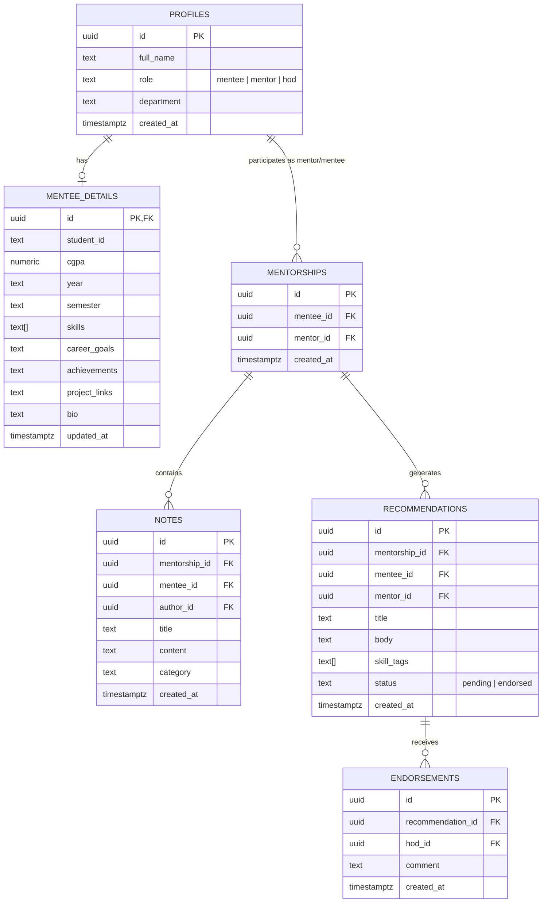

# M&M-Nitte — Mentorship OS

> **Guidance that glows. Careers that follow.**  
> A unified, role-based mentorship platform tailored for academic institutions (NMAMIT Nitte) connecting **Mentees**, **Mentors**, and **Heads of Departments (HOD)** in a modern, glassmorphic workspace.

---

## 🌟 Overview

**M&M-Nitte** streamlines and elevates the institutional mentorship process. Students build holistic academic and career portfolios, mentors track mentee progress and issue categorized guidance notes and formal recommendations, while HODs review, endorse, and analyze mentorship activity across all academic departments.

---

## ✨ Features by Role

### 🎓 1. Mentee (Student)
- **Profile Studio**: Manage comprehensive academic details including CGPA, year, semester, student ID, department, skills tagger, career aspirations, accomplishments, project links, and bio.
- **Profile Completion Meter**: Real-time progress bar computing profile completeness.
- **Guidance & Notes Feed**: Real-time feed of feedback and guidance from assigned mentors (categorized as *General*, *Strength*, *Needs Improvement*, or *Goal*).
- **Recommendation & Endorsement Hub**: View formal mentor recommendations and official HOD endorsements.
- **Interactive Journey Timeline**: Visual 4-stage tracking:
  `Profile Shared` ➔ `Mentor Assigned` ➔ `Recommendation Received` ➔ `HOD Endorsed`.

### 👨‍🏫 2. Mentor (Faculty)
- **Mentee Roster & Live Search**: Fast search across adopted mentees by name, department, or technical skill tags with quick academic badges (CGPA, year, note counts).
- **Mentee Adoption Portal**: Browse unassigned student profiles across departments and adopt new mentees with one click.
- **Dedicated Mentee Workspace**:
  - Deep-dive into student profile, academic records, and career goals.
  - Create categorized mentorship notes.
  - Draft and submit formal recommendations with skill tags directly to the HOD for endorsement.

### 🏛️ 3. Head of Department (HOD)
- **HOD Console**: High-level command center with live counts of pending reviews, completed endorsements, and total recommendations.
- **Pending Review Pipeline**: Inspect mentor recommendations, review the mentee's full portfolio in an interactive modal, and provide official endorsements with custom feedback comments.
- **All Mentees Directory**: Searchable institutional repository of all student profiles across years and departments.
- **Reports & Analytics**:
  - Live metric distribution breakdowns (Mentees by Department, Mentees by Year, Recommendation Statuses, Recommendations per Mentor).
  - Overall endorsement success rate.
  - **One-Click CSV Export**: Download institutional mentorship reports directly to CSV.

---

## 🎨 Design System: "LUMEN"

The user interface is powered by custom glassmorphism design:
- **Ambient Animated Background**: Layered floating gradient mesh blobs and subtle noise textures.
- **Modern Typography**: Paired Google Fonts ([Sora](https://fonts.google.com/specimen/Sora) for bold headers and [Inter](https://fonts.google.com/specimen/Inter) for clean UI readability).
- **Micro-Interactions**: Parallax mouse-follow tilts, smooth hover elevation, shimmer buttons, and responsive side drawers for mobile viewports.

---

## 🛠️ Tech Stack

- **Frontend**: HTML5, Vanilla JavaScript (ES6+ Modules), Modern CSS3 (CSS Variables, Flexbox, CSS Grid, Backdrop Filters).
- **Backend & Database**: [Supabase](https://supabase.com) (PostgreSQL database, Row Level Security, Auth & Sessions).
- **Libraries**: `@supabase/supabase-js` (via CDN).
- **No Build Tools Required**: Zero dependencies or compilation steps — runs directly in modern web browsers or lightweight static hosts.

---

## 🗄️ Database Architecture

The platform relies on 6 core relational tables configured in [`supabase-schema.sql`](./supabase-schema.sql):



---

## 🚀 Quickstart & Setup

### 1. Clone the Repository
```bash
git clone https://github.com/sayed123-ai/ui_task2.git
cd ui_task2
```

### 2. Configure Database (Supabase)
1. Create a free project on [Supabase](https://supabase.com).
2. Go to the **SQL Editor** in your Supabase dashboard.
3. Paste and run the entire contents of [`supabase-schema.sql`](./supabase-schema.sql).
4. In `index.html`, locate lines 332–333 and replace the placeholder credentials with your Supabase Project URL and Anon API key:
   ```javascript
   const SUPABASE_URL  = "https://YOUR_PROJECT.supabase.co";
   const SUPABASE_ANON = "YOUR_ANON_PUBLIC_KEY";
   ```

### 3. Run Locally
Because this is a zero-build client app, you can launch it with any local static server:

#### Using Python:
```bash
python -m http.server 3000
```
#### Using Node.js:
```bash
npx serve .
```
#### Using VS Code:
Right-click `index.html` and choose **"Open with Live Server"**.

Visit `http://localhost:3000` in your browser.

---

## 📂 Project Structure

```text
mentor-mentee-app/
├── index.html           # Single-page application (UI, Styles, Client logic & Supabase integration)
├── supabase-schema.sql  # Complete PostgreSQL schema, constraints, and Row Level Security policies
└── README.md            # Comprehensive project documentation
```

---

## 🔒 Security & Row Level Security (RLS)

- **Role Verification**: User roles (`mentee`, `mentor`, `hod`) are assigned during registration in Supabase metadata and saved to the `profiles` table.
- **Row Level Security**: Tables are guarded with RLS policies so that:
  - Mentees can only update their own profile and details.
  - Mentors can create notes and recommendations for their assigned mentees.
  - HODs have authorization to review recommendations, submit official endorsements, and view department-wide reports.

---

## 📄 License

This project is licensed under the [MIT License](LICENSE).
